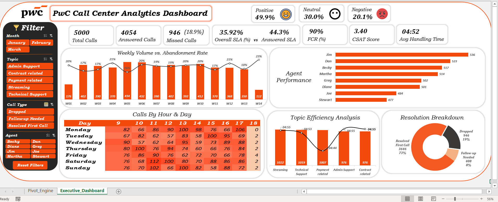

# PwC Call Center Analytics (Excel)

## 1. Project Overview & Business Problem
This project presents an end-to-end **Executive Call Center Analytics Dashboard** developed in **Microsoft Excel**, inspired by the **PwC Digital Intelligence** power-user case study. 

The dashboard analyzes **5,000 customer calls** handled across **8 agents** and **5 service departments** during **Q1 (January – March)**. The primary objective is to give operations leadership a single source of truth to monitor Service Level Agreements (SLA), diagnose call abandonment bottlenecks, evaluate shift capacity across hours and days, and benchmark individual agent productivity vs. service quality.

---
## 2. Technical Architecture & BI Workflow

### 🔹 A. ETL & Data Transformation (`Power Query`)
* **Data Cleaning & Standardization:** Imported raw call logs, standardized date/time formats, converted talk durations into `mm:ss` metrics, and handled null entries for unpicked calls.
* **Feature Engineering:** Created conditional dimension attributes to support granular slicing, including:
  * **`Call Type`:** Categorized calls into `Resolved First Call`, `Follow-up Needed`, and `Dropped`.
  * **`CSAT Sentiment Tiers`:** Grouped customer ratings (`1–5`) into `Positive` (4–5), `Neutral` (3), and `Negative` (1–2).
  * **`Chronological Time Buckets`:** Extracted `Month`, `Week Label` (`W01–W14`), `Day of Week`, and `Hour of Day` (`9:00–18:00`).

### 🔹 B. Data Modeling (`Power Pivot` Star Schema)
* Built a relational **Star Schema** data model connecting the central fact table (`Fact_Calls`) to dimension tables (`Dim_Date`, `Dim_Agents`, `Dim_Topics`).
* Configured **`Sort by Column`** rules on calendar and weekday tables to enforce true chronological sorting (`January → February → March` and `Monday → Sunday`) across all PivotTables and Slicers.

### 🔹 C. Analytical Measures (`DAX`)
Authored custom DAX measures to separate queue-level capacity from agent-level execution:

| KPI / Measure | Value | Analytical Purpose |
| :--- | :--- | :--- |
| **Total Calls** | `5,000` | Total inbound call demand across Q1. |
| **Answered Calls** | `4,054` | Total calls successfully connected to an agent (`81.1%` of demand). |
| **Missed Calls (Abandonment %)** | `946 (18.9%)` | Calls dropped in queue before agent pickup. |
| **Overall SLA (%)** | `35.92%` | True customer-facing SLA compliance across **all** inbound calls (including drops). |
| **Answered SLA (%)** | `44.30%` | Speed-of-answer compliance measured strictly on **answered** calls. |
| **Net FCR (%)** | `90.0%` | First Call Resolution rate out of total answered calls (`3,646` resolved on 1st contact). |
| **CSAT Score** | `3.40 / 5.0` | Average post-call customer satisfaction rating. |
| **Avg Handling Time (AHT)** | `04:52` | Mean talk and handling duration per answered call. |
| **Customer Sentiment Split** | `49.9%` Pos / `30.0%` Neu / `20.1%` Neg | Distribution of post-call customer satisfaction ratings. |

### 🔹 D. Dashboard UI/UX Design
* **Dark Control Sidebar:** Consolidated 4 multi-connected Slicers (`Month`, `Topic`, `Call Type`, `Agent`) with a one-click **`Reset Filters`** button.
* **Dynamic Heatmap Stabilization:** Engineered a Camera-linked `Calls By Hour & Day` conditional heatmap with locked column widths and zero-value preservation (`Show items with no data`) to prevent layout shifting during filtering.

---

## 3. Key Business Insights

### 1. The SLA Illusion: Queue Wait-Time vs. Agent Pickup (`8.38%` Gap)
* Looking solely at **`Answered SLA (44.3%)`** masks the broader queue problem: when factoring in the **946 abandoned calls (18.9%)**, true customer-facing compliance drops to **`Overall SLA: 35.92%`**.
* **Diagnosis:** An **8.38% compliance loss** occurs before an agent ever picks up the phone, proving the primary bottleneck is queue wait-time and line availability rather than agent conversation length.

### 2. Calendar Boundary Effects & End-of-Quarter Abandonment Spikes (`W01` vs. `W05` vs. `W14`)
* **Partial Calendar Weeks (`W01` & `W14`):** Because Q1 spans 90 days (~12.8 weeks), **Week 1 (176 calls)** and **Week 14 (112 calls)** represent partial calendar weeks at the start of January and end of March, whereas full operational weeks consistently average **368–434 calls**.
* **Operational Paradox:** During the single highest demand week of the quarter (**`W05: 434 calls`**), the abandonment rate dropped to a quarter-low of **`16%`**, proving that the 8-agent team can comfortably absorb high call volume when fully focused on the queue. Conversely, abandonment spiked to **`23%` in `W14`**, pointing to **real-time queue adherence gaps** during end-of-quarter wrap-up days rather than excess customer demand.

### 3. Single-Shift Capacity & Pre-Closing Congestion (`9:00 AM – 6:00 PM` Roster)
* **Shift Structure:** The hourly heatmap confirms the center operates a single **9:00 AM – 6:00 PM daytime shift** (with the `18:00` column capturing only **16 residual overflow calls** logged right at the 6:00 PM cutoff).
* **Weekend Midday Surge:** The heaviest hourly demand hits on **Saturdays between 11:00 AM and 12:59 PM (`112` and `100` calls)** and **Sundays at 11:00 AM (`102` calls)**.
* **Last-Hour Bottleneck (`17:00 – 17:59`):** A major weekday wave occurs in the final hour before shift close, peaking on **Mondays at 5:00 PM (`106` calls)** and **Tuesdays at 3:00 PM (`100` calls)**. Allowing offline admin work, meetings, or breaks during this late-afternoon window directly inflates dropped calls.

### 4. Uniform AHT Across Technical & Transactional Topics (`04:44` vs. `04:55`)
* Call volume is evenly distributed across all 5 service topics (~20% each, ranging from **`976` calls** in `Admin Support` / `Contract related` to **`1,022` calls** in `Streaming`).
* Average Handling Time shows a tight spread of only **11 seconds** across departments—from **`04:44`** in `Payment related` (`1,007` calls) to **`04:53`** in `Technical Support` (`1,019` calls) and **`04:55`** in `Streaming`, `Admin Support`, and `Contract related`.
* **Diagnosis:** Routine transactional inquiries (`Payment related` and `Admin Support`, representing **1,983 calls or ~40% of total workload**) consume nearly the same ~5-minute handling time as complex technical troubleshooting (`04:53`). This indicates slow internal billing/CRM lookup workflows for simple requests.

### 5. Resolving the `90% FCR` vs. `3.40 CSAT` Paradox
* Once a caller connects with an agent, resolution efficiency is high: **3,646 calls (`73%` of total inbound | `90%` of answered calls)** are resolved on the first call, while only **408 calls (`8%`)** require follow-up.
* Despite a **90% Net FCR**, **50.1%** of customer ratings remain Neutral (**30.0%**) or Negative (**20.1%**). Customers are penalizing the call center in post-call surveys for **pre-call queue wait times** (`55.7%` SLA miss on answered calls), not for unresolved issues.

### 6. Agent Productivity Spread (`Jim` vs. `Stewart` & `Joe`)
* Top performers **`Jim` (`536` calls)**, **`Dan` (`523` calls)**, **`Becky` (`517` calls)**, and **`Martha` (`514` calls)** consistently lead team throughput, outpacing **`Joe` (`484` calls)** and **`Stewart` (`477` calls)**—a **59-call productivity gap** between the top and bottom tiers across Q1.

---

## 4. Strategic Recommendations

1. **Enforce Peak & Pre-Closing Queue Lockdowns (`11:00–13:00` & `15:00–18:00`):**
   * Restrict offline wrap-up tasks, team meetings, and break rotations during the **Saturday/Sunday midday peak (`11:00–13:00`)** and the **weekday pre-closing surge (`16:00–18:00`)** to capture dropped calls before shift close.
2. **Streamline Transactional Workflows (`Payment` & `Admin Support`):**
   * Since `Payment related` (`1,007` calls) and `Admin Support` (`976` calls) take nearly 5 minutes per call despite being non-technical, introducing quick-lookup CRM templates or self-service status notifications can shave 60–90 seconds off transactional AHT and free up capacity to absorb the **946 missed calls**.
3. **Targeted Peer Coaching for Bottom-Quartile Agents:**
   * Pair **`Stewart` (`477` calls)** and **`Joe` (`484` calls)** with top-tier agents (**`Jim`** and **`Dan`**) for call shadowing focused on faster call wrap-up and pickup readiness, aiming to lift bottom-tier throughput to the **505+ call** team benchmark.

---

## 5. How to Use This Dashboard
1. Clone this repository or download `PwC Analysis.xlsx`.
2. Open the workbook in **Microsoft Excel** and click **Enable Content / Macros** if prompted.
3. Use the left-hand **Filter Sidebar** (`Month`, `Topic`, `Call Type`, `Agent`) to slice all KPIs and charts dynamically, or click **`Reset Filters`** to restore the full Q1 view.
